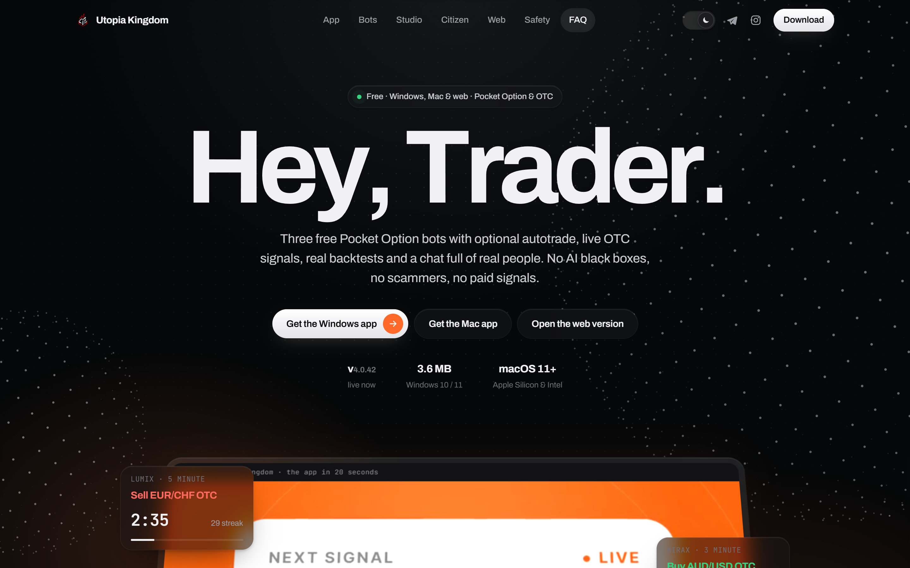
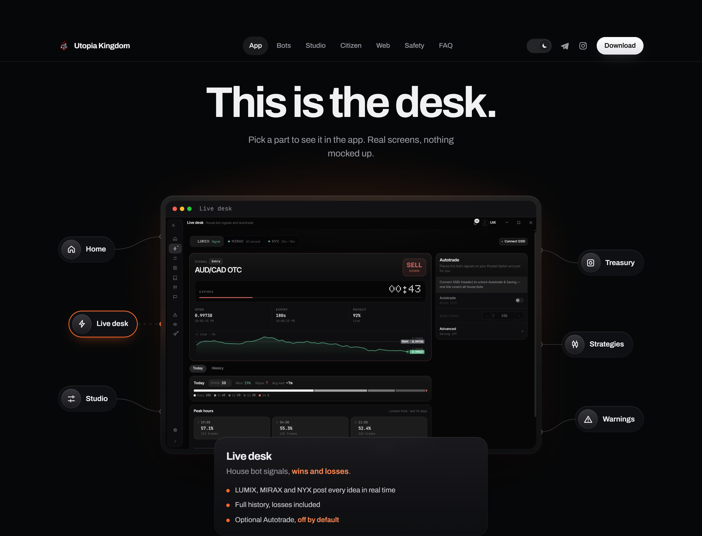
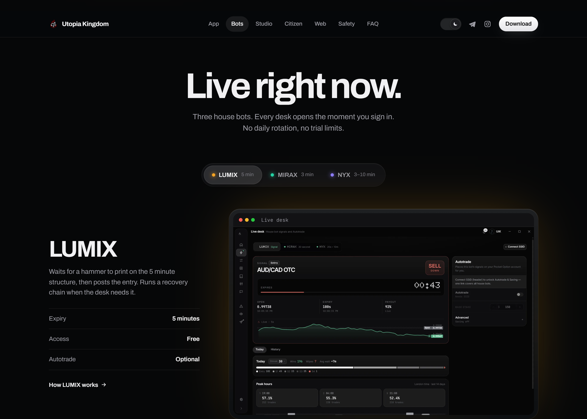
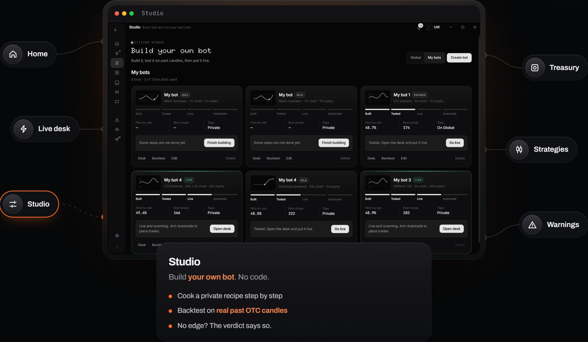

# Utopia Kingdom — Free Pocket Option Bots, OTC Signals & Backtesting

**Three free house bots. An open signal log. Real OTC backtests. A human-only trading chat.**

---

## What is this?

[Utopia Kingdom](https://utkingdom.com) is a free desktop app (Windows and Mac) for Pocket Option traders who are tired of
"99% win" schemes, AI black boxes and paid VIP signal groups.

- **Free bots** for Pocket Option OTC — signals, with optional Autotrade
- **Open signal log** — every idea posted in real time, losses included
- **Bot builder + backtester** — test your own strategy on real past OTC candles
- **Human-only chat** — scam links auto-banned, DM sellers removed

No trial limits. No daily rotation. Every desk opens the moment you sign in.

## The free bots

| Bot | Expiry | What it does | Access | Autotrade |
|---|---|---|---|---|
| **LUMIX** | 5 min | Waits for a hammer on the 5-minute structure, then posts the entry. Runs a recovery chain when needed. | Free | Optional |
| **MIRAX** | 3 min | Scans live OTC and posts steady 3-minute entries when the setup lines up. | Free | Optional |
| **NYX** | 3–10 min | Watches OTC pairs near high payout and picks the pair and expiry from live structure. | Free | Optional |

## OTC backtesting (Studio)

Build your own bot and test it before risking a cent.

1. **Cook** — build a private recipe step by step. No code needed.
2. **Backtest** — run it on real past OTC history from real brokers. Not randomized, not curve-fit.
3. **Live** — desk, tape, history, and Autotrade if you want it.

If a recipe has no edge, the backtest says so. Honestly.

## Open signal log

All house-bot ideas are public, wins and losses: **[utkingdom.com/signals](https://utkingdom.com/signals/)**

- Live feed from LUMIX, MIRAX and NYX
- Full history of every idea
- 9 OTC setups with exact entry rules

## Get started

1. [Download the app](https://utkingdom.com/download)
2. Sign in
3. Open a desk — done

Everything above is free. An optional **€20/month Citizen** plan exists for people who want to back the project.

## What this is *not*

- ❌ Not a "99% win" scheme
- ❌ Not an AI black box
- ❌ Not a VIP signal seller
- ❌ Not a fund or account manager

## Links

- 🌐 Website: https://utkingdom.com
- 📈 Signal log: https://utkingdom.com/signals/
- ⬇️ Download: https://utkingdom.com/download
- 💬 Telegram: https://t.me/utkingdom
- 📸 Instagram: https://www.instagram.com/kainfeofficial/

---

> **⚠️ Risk warning.** Binary options and OTC trading are high risk. **Most people lose money.**
> Signals and bots are for learning only. Nothing here is financial advice or a recommendation.
> Past patterns do not mean future wins. Only trade money you can afford to lose.

Built solo since 2024. Not affiliated with or endorsed by Pocket Option.
